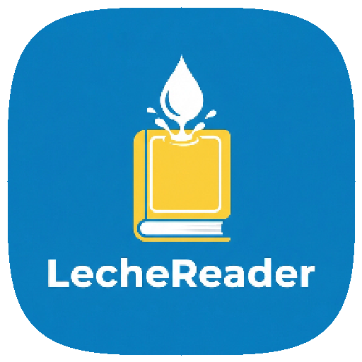

<p align="center">
  
</p>

<h1 align="center">LecheReader</h1>

<p align="center">
  A calm, editorial book reader for Android, built with Flutter.<br />
  Local library, simple imports and a carefully crafted reading experience:
  cream paper, ink and terracotta.
</p>

<p align="center">
  <a href="README.md">Español</a> · <strong>English</strong>
</p>

## Features

- Visual library with covers, progress and status filters.
- «Continue reading» card to pick up your last book.
- File import with local copy, metadata, cover and duplicate detection.
- Built-in readers for paginated text, PDF and CBZ comics.
- Reading themes (paper, sepia, night and slate), typography, size, line
  height, margins and justification.
- Bookmarks, table of contents and automatic progress saving.
- Custom shelves with color and cover.
- Local search by title, author, publisher or description.
- Spanish interface and light/dark themes.

## Formats

| Format | Reading |
| --- | --- |
| PDF | Native with pdfrx |
| EPUB | Custom pagination in Flutter |
| TXT | Custom pagination in Flutter |
| FB2 | Custom pagination in Flutter |
| HTML | Custom pagination in Flutter |
| CBZ | Image viewer with zoom |
| CBR / RAR | They can be imported, but must be converted to CBZ to read |
| MOBI / AZW3 | Planned for a second phase |

## Stack

- Flutter and Dart
- Riverpod 3 for state
- go_router for navigation
- SQLite (`sqflite` on Android, `sqflite_common_ffi` on desktop)
- pdfrx for PDF
- `archive`, `xml`, `html` and `image` for metadata and content

## Development

```bash
flutter pub get
flutter run -d linux      # desktop
flutter run -d android    # device or emulator
```

Checks:

```bash
flutter analyze
flutter test
flutter build apk --debug
```

Android icons are generated from `tool/icon_source.jpg`:

```bash
dart run tool/generate_launcher_icons.dart
```

The app works offline and does not send books to any server.

## Structure

```
lib/
  core/
    data/       SQLite database
    models/     Books, shelves, bookmarks and settings
    router/     go_router routes
    theme/      Palette, typography and themes
    widgets/    Shared components
  features/
    import/     File selection, copy and metadata
    library/    Library and book detail
    reader/     Text, PDF and comic readers
    search/     Local search
    shelves/    Shelves
    settings/   Settings
```

## Status

Functional MVP. CBR/RAR and Kindle formats are out of scope for this first
release. The app can also be built for Linux and, later, on Windows and macOS.
