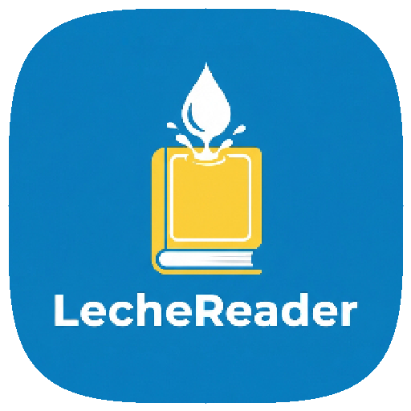

<p align="center">
  
</p>

<h1 align="center">LecheReader</h1>

<p align="center">
  Un lector de libros tranquilo y editorial para Android, construido con Flutter.<br />
  Biblioteca local, importación sencilla y una experiencia de lectura cuidada:
  papel crema, tinta y terracota.
</p>

<p align="center">
  <strong>Español</strong> · <a href="README.en.md">English</a>
</p>

## Funciones

- Biblioteca visual con portadas, progreso y filtros por estado.
- Tarjeta «Continuar leyendo» para retomar la última lectura.
- Importación de archivos con copia local, metadatos, portada y detección de
  duplicados.
- Lectores propios para texto paginado, PDF y cómics CBZ.
- Temas de lectura (papel, sepia, noche y pizarra), tipografía, tamaño,
  interlineado, márgenes y justificación.
- Marcadores, índice y guardado automático del progreso.
- Estanterías personalizadas con color y portada propia.
- Búsqueda local por título, autor, editorial o descripción.
- Interfaz en español y temas claro/oscuro.

## Formatos

| Formato | Lectura |
| --- | --- |
| PDF | Nativa con pdfrx |
| EPUB | Paginación propia en Flutter |
| TXT | Paginación propia en Flutter |
| FB2 | Paginación propia en Flutter |
| HTML | Paginación propia en Flutter |
| CBZ | Visor de imágenes con zoom |
| CBR / RAR | Se importan, pero hay que convertirlos a CBZ para leerlos |
| MOBI / AZW3 | Pendiente para una segunda fase |

## Stack

- Flutter y Dart
- Riverpod 3 para el estado
- go_router para la navegación
- SQLite (`sqflite` en Android, `sqflite_common_ffi` en escritorio)
- pdfrx para PDF
- `archive`, `xml`, `html` e `image` para metadatos y contenido

## Desarrollo

```bash
flutter pub get
flutter run -d linux      # escritorio
flutter run -d android    # dispositivo o emulador
```

Comprobaciones:

```bash
flutter analyze
flutter test
flutter build apk --debug
```

Los iconos de Android se generan desde `tool/icon_source.jpg`:

```bash
dart run tool/generate_launcher_icons.dart
```

La aplicación funciona sin conexión y no envía libros a ningún servidor.

## Estructura

```
lib/
  core/
    data/       Base de datos SQLite
    models/     Libros, estanterías, marcadores y ajustes
    router/     Rutas de go_router
    theme/      Paleta, tipografía y temas
    widgets/    Componentes compartidos
  features/
    import/     Selección, copia y metadatos de archivos
    library/    Biblioteca y detalle de libro
    reader/     Lectores de texto, PDF y cómics
    search/     Búsqueda local
    shelves/    Estanterías
    settings/   Ajustes
```

## Estado

MVP funcional. CBR/RAR y los formatos Kindle quedan fuera de esta primera
entrega. La app está preparada para compilar también en Linux y, más adelante,
en Windows y macOS.
